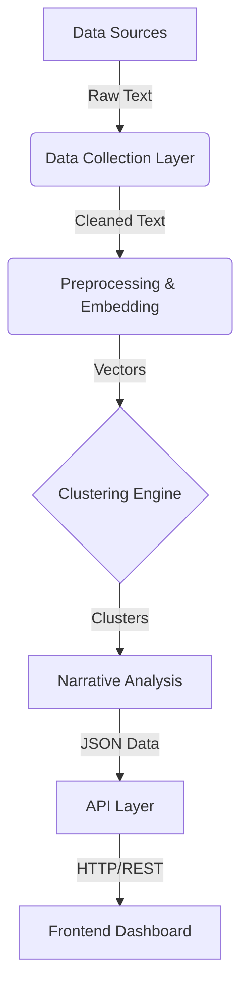

# Technical Architecture

## System Overview
The Echelon 2.0 architecture is a linear **ETL (Extract, Transform, Load)** pipeline enhanced with AI processing steps, feeding into a real-time React frontend.

## 1. Data Collection Layer
*   **Scripts**: Located in `backend/data_collectors/`.
*   **Function**: Python scripts periodically poll external APIs (News, Prices) and scrape target websites.
*   **Output**: Raw JSON/CSV files containing headlines, summaries, and timestamps.

## 2. Preprocessing & Embedding Layer
*   **Text Cleaning**: Removes stop words, HTML tags, and duplicates.
*   **Vectorization**: The core innovation. We use a **Sentence Transformer** model (e.g., `all-MiniLM-L6-v2`) to convert every news article into a 384-dimensional vector.
    *   *Why?* Computers can't understand "strike at mine" vs "labor stoppage". But as vectors, these two phrases appear very close in mathematical space.

## 3. The Clustering Engine (The Core)
*   **Algorithm**: DBSCAN (Density-Based Spatial Clustering of Applications with Noise) or K-Means.
*   **Logic**:
    1.  The engine looks at the map of thousands of article vectors.
    2.  It identifies "dense" regions where many articles talk about the same thing.
    3.  It groups them into a **Cluster** (a Narrative).
    4.  Outliers are classified as "Noise" and discarded.

## 4. Narrative Analysis & Sentiment
*   **Summarization**: An LLM (or keyword extractor) reads the articles in a cluster to generate a title (e.g., "Fed Interest Rate Hike").
*   **Sentiment Scoring**: Each article is scored (-1 to +1). The cluster gets an average score.
*   **Relevance Weighting**: Newer articles weigh more heavily than older ones.

## 5. API & Frontend Layer
*   **API**: A lightweight FastAPI server exposes endpoints like `/api/clusters` and `/api/metrics`.
*   **Frontend**: The React app fetches this data on load.
    *   **Dashboard**: Displays the High-Level "Cards" for each narrative.
    *   **Narrative Map**: Uses the vector coordinates to plot dots on a 2D scatter plot, visualizing the market landscape.
