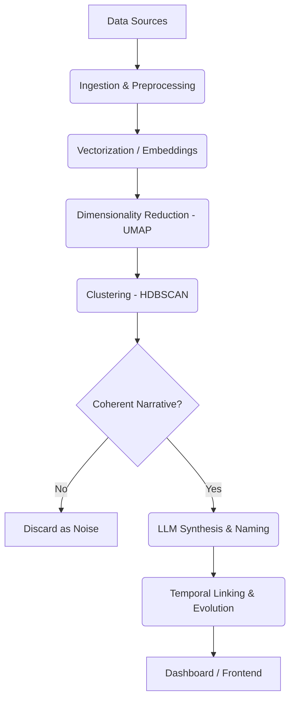

# Narrative Detection Agent (Autonomous Pattern Hunter) - Implementation Plan

## 1. Problem Statement & Objective
**Goal:** Build an autonomous agent that continuously scans stock market data to detect, name, and track emerging narratives (e.g., "AI Bubble Fears," "Fed Rate Hike Optimism," "GameStop Short Squeeze 2.0").
**Key Capabilities:**
-   Unsupervised clustering (no predefined categories).
-   Noise rejection (ignoring random chatter).
-   Narrative naming & summarization.
-   Temporal tracking (merging/splitting over time).

---

## 2. High-Level Architecture (The Pipeline)


a
---

## 3. Technology Stack (Hackathon Optimized)

| Component | Technology | Reasoning |
| :--- | :--- | :--- |
| **Language** | **Python 3.10+** | Standard for ML/Data Science. |
| **Embeddings** | **Sentence-Transformers** (`all-MiniLM-L6-v2`) | Fast, lightweight, efficient for running locally or on small instances. |
| **Clustering** | **BERTopic** (or UMAP + HDBSCAN manual) | BERTopic handles the heavy lifting of embedding+clustering+TF-IDF for keyword extraction out of the box. |
| **LLM (Synthesis)** | **OpenAI GPT-4o** or **Groq (Llama 3)** | Need high speed and reasoning for summarization. Groq is great for real-time applications. |
| **Vector DB** | **ChromaDB** or **FAISS** | Simple local storage for embeddings to query historical data. |
| **Backend API** | **FastAPI** | High performance async API to serve the frontend. |

---

## 4. Step-by-Step Implementation Guide

### Phase 1: Data Ingestion (The "Eyes")
We need text data relevant to stock markets.
-   **Target:** Select 5-10 volatile tickers (e.g., NVDA, TSLA, AAPL, AMC) or general keywords ("Interest Rates", "Inflation").
-   **Sources:**
    1.  **News**: *NewsAPI* or *Yahoo Finance* (using `yfinance` python library to scrape news).
    2.  **Social**: *Reddit* (r/wallstreetbets, r/stocks) using `PRAW`.
    3.  **Twitter/X**: (Harder to get free API access, maybe skip for hackathon or use specific scrapers if allowed).

**Action Item:** Create scripts to fetch last 24h of headlines/comments and store in a simple CSV/JSON.

### Phase 2: The Logic Core (Embedding & Clustering)
This is where the "Pattern Hunting" happens.
1.  **Embed**: Convert every headline/comment into a 384-dimensional vector.
2.  **Cluster**: Feed vectors into the Clustering Engine.
    -   *Why HDBSCAN?* It has a concept of "outliers" (noise). Points that don't fit a cluster are labeled `-1`. This fulfills the requirement: *Decides what constitutes a "coherent narrative" vs random noise.*
    -   **Parameters**: `min_cluster_size` is crucial. Set it to something like 5 or 10 ensures we only care if multiple sources say similar things.

### Phase 3: Narrative Synthesis (The "Brain")
Once we have a cluster (e.g., Cluster #5 has 50 headlines about "Nvidia" and "China Ban"):
1.  **Representative Docs**: Take the 5 most central documents in the cluster (closest to centroid).
2.  **LLM Prompting**:
    > "Here are 5 headlines from a cluster: [List]. 
    > 1. Give this narrative a short, punchy title (max 5 words). 
    > 2. Summarize the sentiment (Bullish/Bearish/Neutral). 
    > 3. Explain the core driver."
3.  **Output**: "Nvidia Chips Restricted in China" (Bearish).

### Phase 4: Temporal Tracking (The "Memory")
Narratives change.
-   **Snapshotting**: Run the pipeline every hour (or X minutes).
-   **Linking**:
    -   Compare *New Cluster Centroid* vs *Old Cluster Centroid*.
    -   If Cosine Similarity > 0.8: It's the **same narrative** continuing. Update the timestamp and add new docs.
    -   If Cosine Similarity is moderate (0.5 - 0.8): It might be a **merge** or **split**.
    -   If low: **New Narrative**.

---

## 5. Directory Structure Plan

```text
/backend
    /data_collectors
        reddit_scraper.py
        news_scraper.py
    /ml_engine
        narrative_hunter.py  <-- Main Logic
        clustering_utils.py
        topic_naming.py      <-- LLM calls
    /api
        main.py              <-- FastApi endpoints
    requirements.txt
```

## 6. Hackathon Shortcuts (MVP Strategy)
-   **Don't train an LLM**: Use API calls (OpenAI/Anthropic/Groq).
-   **Don't build a complex UI yet**: Just output JSON or a simple Streamlit dashboard to visualize the clusters.
-   **Use BERTopic**: It abstracts away UMAP/HDBSCAN and gives you topic keywords automatically. It's a huge time-saver. 

## 7. Next Steps for You
1.  Install dependencies: `pip install bertopic sentence-transformers openai fastapi uvicorn praw yfinance`
2.  Write the `reddit_scraper.py` to get some raw text.
3.  Run a test script to see if BERTopic detects coherent themes in that text.
